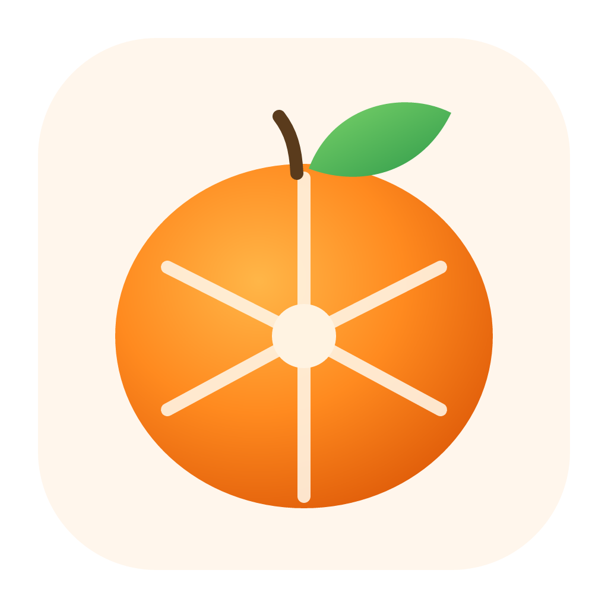

<p align="center"></p>

<h1 align="center">Satsuma</h1>

<p align="center"><b>Drag a file. Hold a key. Drop it on the wheel.</b><br>
An open-source, offline file converter for macOS, written in Rust.</p>

---

Satsuma lives in the menu bar. Start dragging any file, from Finder or any other app, and hold a key. A wheel opens under the cursor:

| Hold | Wheel | Examples |
|---|---|---|
| **⇧ Shift** | **Convert** | HEIC → JPG, MOV → MP4, PDF → DOCX, XLSX → CSV, SRT → VTT, RAR → ZIP |
| **⌘ Command** | **Tools** | Compress, resize, rotate, strip metadata, merge PDFs, split pages, extract audio, make a thumbnail |
| **⌃ Control** | **Actions** | AirDrop, Float, Copy, Move…, Copy path, open in Terminal |

Drop the file on a slice and the result appears next to the original. You can let go of the key once the wheel is open; dropping in the centre cancels.

Nothing is uploaded. Conversions run on your Mac, using Rust crates, macOS's own frameworks and ffmpeg.

> Satsuma is an independent project inspired by the drag-and-hold workflow of [Tangerine for Mac](https://tangerineformac.com/). It isn't affiliated with Tangerine and shares no code with it.

## Features

- **Drag, hold, drop**: no Accessibility permission needed (see [How it works](#how-it-works)).
- **Keyboard and click mode**: press <kbd>⌥⌘T</kbd> to open the wheel for the Finder selection. Use arrow keys and <kbd>Enter</kbd>, <kbd>Tab</kbd> or <kbd>1</kbd>–<kbd>3</kbd> to switch wheels, and <kbd>Esc</kbd> to close.
- **Multiple files**: the wheel shows only the conversions that apply to every selected file, plus merge tools when they make sense.
- **Float shelf**: park files in a small always-on-top window and drag them out later.
- **Settings**: choose the trigger keys, where results go (next to the original, Downloads or a folder you pick), quality, PDF/SVG resolution and launch at login.
- **CLI**: the same engine runs from the command line as `satsuma`.

### Formats

| Family | Reads | Writes |
|---|---|---|
| Images | JPG, PNG, WebP, HEIC/HEIF, AVIF, TIFF, BMP, GIF, ICO, TGA, SVG | JPG, PNG, WebP, HEIC, AVIF, TIFF, GIF, BMP, ICO, PDF |
| Audio | MP3, M4A/AAC, WAV, FLAC, OGG, Opus, AIFF, WMA, CAF | MP3, M4A, WAV, FLAC, OGG, Opus, AIFF, WMA |
| Video | MP4, MOV, M4V, MKV, WebM, AVI, WMV, FLV, MPEG, 3GP, TS | MP4, MOV, MKV, WebM, AVI, WMV, GIF, plus MP3/M4A/WAV soundtrack |
| PDF | PDF | PNG/JPG/TIFF (one per page), DOCX, ODT, RTF, HTML, TXT, Markdown, EPUB |
| Documents | DOCX, DOC, ODT, RTF, TXT, HTML, Markdown, EPUB, WebArchive (Pages with LibreOffice) | DOCX, ODT, RTF, PDF, HTML, TXT, Markdown, EPUB |
| Slides | PPTX, PPT, ODP, Keynote (*requires LibreOffice*) | PDF, PPTX, ODP |
| Spreadsheets | XLSX, XLSM, XLS, XLSB, ODS, CSV, TSV | XLSX, CSV, TSV, JSON, HTML, Markdown |
| Subtitles | SRT, VTT | SRT, VTT, TXT |
| Archives | ZIP, RAR, 7z, TAR, TGZ, GZ, BZ2, XZ, ISO | Extract, ZIP, TAR.GZ |

Any file or folder can also be zipped.

## Install

**Requirements:** macOS 13 or later. Development so far has been on Apple silicon.

1. Download the latest `.dmg` from [Releases](../../releases) and drag **Satsuma** to Applications.
2. Install ffmpeg for audio and video: `brew install ffmpeg`.
3. Optional: install [LibreOffice](https://www.libreoffice.org/) for slides and better Office → PDF output.

Builds aren't notarised yet. The first time you open the app, right-click it and choose **Open**.

### Build from source

```sh
git clone https://github.com/diadieudoucoure/satsuma
cd satsuma
cargo install tauri-cli --version "^2" --locked

# run the app in development
cd app/src-tauri && cargo tauri dev

# or bundle Satsuma.app + .dmg into target/release/bundle/
cargo tauri build
```

## Command line

```sh
cargo install --path crates/cli

satsuma list photo.heic                   # what can be done with a file
satsuma convert jpg *.heic                # convert:jpg on each file
satsuma convert mp4 clip.mov -o ~/Desktop # write results elsewhere
satsuma run tool:merge a.pdf b.pdf        # any operation id from `list`
satsuma run tool:compress video.mov --json
```

## How it works

```
app (Tauri 2)                                satsuma-core
├─ watcher.rs  mouse buttons, modifier       ├─ registry  operations() / run()
│              flags, drag pasteboard        ├─ image     image, resvg, libwebp, sips
├─ wheel.rs    slice layout + drop hit-test  ├─ media     ffmpeg
├─ main.rs     tray, windows, job runner ──▶ ├─ pdf       PDFKit, CoreGraphics, CoreText
└─ ui/         wheel (SVG), settings, float  ├─ document  textutil, LibreOffice
                                             ├─ sheet     calamine, rust_xlsxwriter
                                             └─ archive   bsdtar (libarchive)
```

- **Detecting the drag.** A background thread reads `+[NSEvent pressedMouseButtons]`, `+[NSEvent modifierFlags]` and the change count of the drag pasteboard (`NSPasteboardNameDrag`), which increases whenever any app starts a drag. If the mouse is down, the count has changed and the pasteboard holds file URLs, a drag is in progress. None of these APIs needs Accessibility or Input Monitoring permission.
- **The wheel** is a transparent, borderless window placed at the pop-up-menu level, centred on the cursor. The native drop events give the drop position. Rust hit-tests it against the same geometry the SVG is drawn from.
- **Conversions** run on a worker thread and report progress (ffmpeg's `-progress` output, page counts) back to the wheel's hub.

## Project layout

```
crates/core   conversion engine (library, unit tested)
crates/cli    `satsuma` command
app/src-tauri menu-bar app
app/ui        HTML/CSS/JS for the wheel, settings and float windows
assets        logo sources
```

## Contributing

Issues and pull requests are welcome. Before you open a PR, run:

```sh
cargo fmt --all && cargo clippy --workspace --all-targets -- -D warnings && cargo test --workspace
```

Good first issues:

- Bundle a static ffmpeg build as a Tauri sidecar.
- A trim and crop UI for video and images.
- Signing and notarisation in the release workflow.
- Windows and Linux support. The core is mostly portable; the PDF and drag-watcher modules are macOS-specific.

## License

MIT. See [LICENSE](LICENSE). ffmpeg and LibreOffice run as separate programs under their own licenses.
